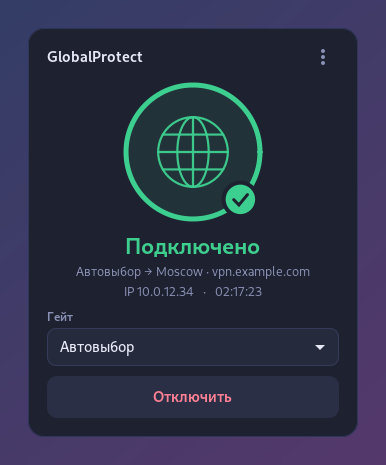
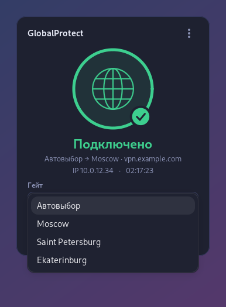
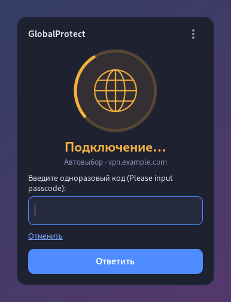
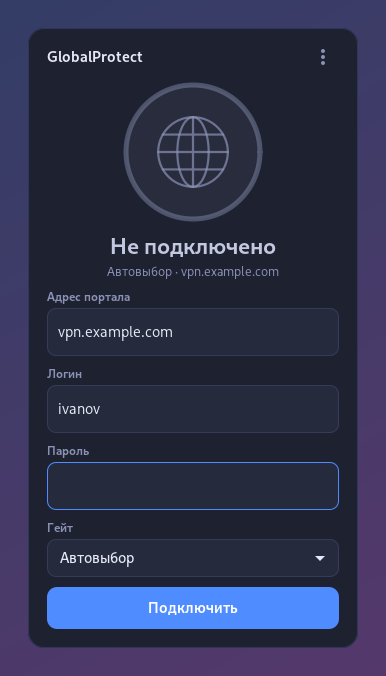
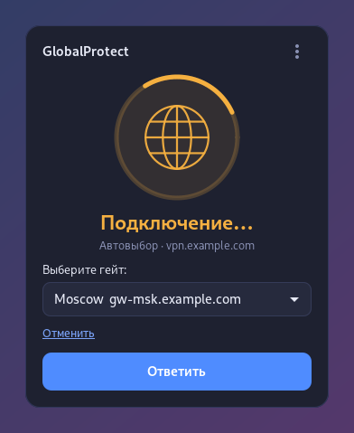
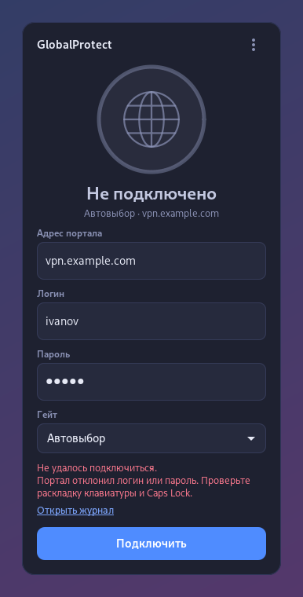

# GlobalProtect-GUI-Debian

Надстройка над **официальным клиентом GlobalProtect** (Palo Alto Networks) для Linux:
значок в трее и панель как в Windows-клиенте — статус, вход, ответы на запросы клиента
(одноразовый код, выбор гейта, подтверждения), смена гейта на лету и подключение прямо
на экране входа, чтобы доменный пользователь мог войти на компьютер, который его ещё не знает.

VPN делает сам официальный клиент (CLI-версия: служба `PanGPS`, агент `PanGPA`, HIP `PanGpHip`) —
надстройка только управляет им через его CLI `globalprotect`. Сам клиент Palo Alto в репозиторий
и пакеты не входит: его выдаёт ваша организация.

| Подключено | Смена гейта | Одноразовый код |
|:-:|:-:|:-:|
|  |  |  |
| **Вход** | **Выбор гейта при входе** | **Ошибка** |
|  |  |  |

## Возможности

- **Панель у значка в трее** — щелчок открывает её над панелью задач: статус, гейт, IP и время
  подключения, кнопка «Подключить / Отключить», журнал. «Внутренняя сеть» — когда клиент сам
  определил, что компьютер в офисе.
- **Вход как у клиента.** Портал, логин и пароль панель подставляет сама; всё остальное, что
  спрашивает клиент, показывает по-человечески и ждёт ответа: одноразовый код (OTP/passcode),
  выбор гейта или сертификата, вопросы «да/нет» (например, о сертификате портала), причину
  отключения, если её требует администратор.
- **Гейты.** «Автовыбор» — лучший гейт по правилам портала; список гейтов — из клиента
  (`show --manual-gateway`), выбор меняет предпочтительный гейт и переподключает на лету.
- **Экран входа (GDM).** При старте компьютера панель открывается на экране входа: можно
  подключить VPN до входа, и новый доменный пользователь получит данные из AD.
- **VPN не рвётся** при входе и выходе пользователей: агент клиента работает одной службой
  `gp-vpn-agent` от служебной учётки `gpvpn`.
- **Автозапуск:** панель на экране входа при старте системы, значок — при входе в сеанс.
  В чистом GNOME значок сам включает расширение
  [AppIndicator](https://extensions.gnome.org/extension/615/appindicator-support/) (ставится вместе с пакетом).
- Пароль хранится только в памяти панели и вводится в клиент через псевдотерминал —
  не в командной строке и не в журнале.
- Меню: забыть сохранённую учётную запись, отправить HIP-отчёт заново, журнал.

## Установка

1. Поставьте **официальный клиент GlobalProtect для Linux, CLI-версию** (пакет `globalprotect`)
   из источника вашей организации, например:
   `sudo apt install ./GlobalProtect_deb-*.deb`.
2. Поставьте надстройку со страницы [Releases](https://github.com/DiMAKES/GlobalProtect-GUI-Debian/releases):

| Система | Файл | Команда |
|---|---|---|
| Debian, Ubuntu, Mint, Astra… | `gp-vpn_*_all.deb` | `sudo apt install ./gp-vpn_*_all.deb` |
| Fedora, RHEL, Alma, Rocky, openSUSE | `gp-vpn-*.noarch.rpm` | `sudo dnf install ./gp-vpn-*.noarch.rpm` (openSUSE: `sudo zypper install …`) |
| Другой Linux с systemd | `gp-vpn-*.tar.gz` | `tar xf gp-vpn-*.tar.gz && sudo ./gp-vpn-*/install.sh` |

Надстройка не зависит от архитектуры (x86_64, arm64 — как у клиента). Зависимости
(Python GTK 3 и т. п.) пакетный менеджер ставит сам.

После установки: «**VPN GlobalProtect**» в меню приложений → адрес портала, логин, пароль →
«Подключить». Значок в трее появится после повторного входа в сеанс.

## Как это устроено

```
gp-vpn-tray (панель, GTK 3) ── от пользователя; на экране входа — от gdm
   │  sudo -n -u gpvpn /usr/libexec/gp-vpn/gp <команда>      (правило /etc/sudoers.d/gp-vpn)
   ▼
gp            ── обёртка: только нужные команды CLI, по одной за раз
   ▼
globalprotect ── официальный CLI ──► PanGPA (служба gp-vpn-agent, учётка gpvpn) ──► PanGPS (gpd)
```

Почему служебная учётка: CLI клиента не работает от системных пользователей (а экран входа —
это системный пользователь `gdm`), а агент `PanGPA` живёт, только пока у пользователя есть
активный сеанс. Поэтому агент запускается системной службой `gp-vpn-agent` с PAM-сеансом
для скрытой учётки `gpvpn`, а личные агенты пользователей отключает drop-in
`/etc/systemd/user/gpa.service.d/gp-vpn.conf` — только пока стоит надстройка.

| Файл | Назначение |
|---|---|
| `/usr/bin/gp-vpn-tray` | панель; `--show` — открыть, `--greeter` — режим экрана входа |
| `/usr/libexec/gp-vpn/gp` | запуск CLI от `gpvpn` с белым списком команд |
| `/usr/libexec/gp-vpn/setup` | настройка при установке: учётка `gpvpn`, служба агента |
| `gp-vpn-agent.service` | агент `PanGPA` клиента от учётки `gpvpn` |

Учтите: VPN общий для компьютера — подключение, сделанное на экране входа или одним
пользователем, видят и могут отключить другие пользователи этого компьютера.

## Сборка

```bash
./build.sh            # deb, rpm, tar
./build.sh deb        # только deb
```

Нужны `dpkg-deb`, для rpm — `rpmbuild` (`sudo apt install rpm`). Пакеты — в `dist/`.

## Что проверено

- Debian 13, GNOME 48 (X11), официальный клиент 6.3.3 (CLI): служба агента от `gpvpn`,
  статус, диалог входа через псевдотерминал до запроса логина на реальном портале.
- Полный сценарий панели — вход, одноразовый код, выбор гейта, смена гейта на лету,
  отключение — на имитации CLI с теми же текстами запросов.
- Ещё не проверены: полное подключение с туннелем на реальном портале, экран входа после
  перезагрузки, rpm и tar.gz на живых системах.

## Ограничения

- Нужна **CLI-версия** клиента. GUI-версия (`PanGPUI`) запускает свой значок и личного агента —
  вместе с надстройкой её не ставьте.
- **Вход через SAML/SSO** в схеме со служебной учёткой пока не поддерживается: клиенту негде
  открыть браузер. Пароль, одноразовые коды и сертификаты из хранилища клиента — работают.
- Сертификат клиента импортирует администратор:
  `sudo install -o gpvpn -m 600 cert.p12 /var/lib/gpvpn/ && sudo -u gpvpn HOME=/var/lib/gpvpn globalprotect import-certificate --location /var/lib/gpvpn/cert.p12`.
- Значок в трее — классический (XEmbed): в GNOME нужен сеанс X11 и расширение трея; в Wayland
  панель открывается из меню приложений.
- Официального клиента Palo Alto под Arch, macOS и BSD для этой схемы нет (для macOS есть
  свой официальный клиент с интерфейсом).

## Лицензия

[GPL-3.0](LICENSE). GlobalProtect — товарный знак Palo Alto Networks; проект с ними не связан.
Предыдущая версия на базе открытого `gpclient` (openconnect) — тег
[v2.0](https://github.com/DiMAKES/GlobalProtect-GUI-Debian/releases/tag/v2.0).
