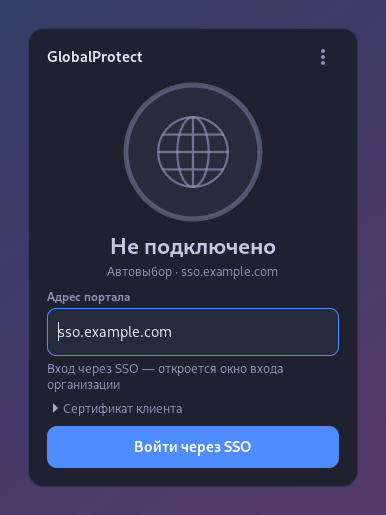
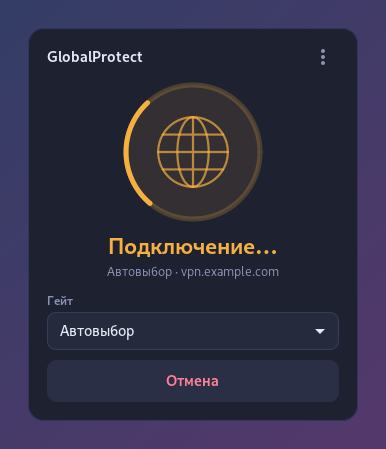

# GlobalProtect-GUI-Debian

Клиент VPN **GlobalProtect** (Palo Alto Networks) для Linux с панелью как в Windows-клиенте:
значок в трее, статус, вход любым способом, который предлагает портал, смена гейта на лету
и подключение прямо на экране входа — чтобы доменный пользователь мог войти на компьютер,
который его ещё не знает.

Подключение делает открытый [`gpclient`](https://github.com/yuezk/GlobalProtect-openconnect)
(на базе OpenConnect); платный GUI «GP Connect» не нужен и в пакеты не входит.

| Подключено | Смена гейта | Вход по паролю |
|:-:|:-:|:-:|
|  |  |  |
| **Вход через SSO** | **Подключение** | **Ошибка** |
|  |  |  |

## Возможности

- **Панель у значка в трее** — щелчок открывает её над панелью задач: статус, IP и время
  подключения, гейт, кнопка «Подключить / Отключить», журнал.
- **Сначала — ответ портала.** По адресу портала панель делает prelogin-запрос и показывает
  ровно тот вход, который требует портал, с его подписями полей:
  - логин и пароль (LDAP, RADIUS, Kerberos-пароль и т. п.);
  - **SSO / SAML** — окно входа организации (`gpauth`), в том числе с MFA на стороне IdP;
  - **сертификат клиента** — `.p12`, `.pfx`, `.pem`, с паролем или без.
- **Гейты.** Первое подключение — через «Автовыбор» (лучший гейт по приоритетам портала).
  Список всех гейтов портала служба запоминает, и дальше гейт меняется на лету из списка;
  при автовыборе видно, куда подключились: «Автовыбор → Москва».
- **Экран входа (GDM).** При старте компьютера панель открывается прямо на экране входа:
  можно подключить VPN до входа, и новый доменный пользователь получит данные из AD.
  VPN работает системной службой и не рвётся при входе и выходе из учётной записи.
- **Автозапуск:** панель на экране входа при старте системы, значок в трее — при входе
  в сеанс. В чистом GNOME значок сам включает расширение
  [AppIndicator](https://extensions.gnome.org/extension/615/appindicator-support/) (оно ставится вместе с пакетом).
- **HIP-отчёт** отправляется автоматически — без него многие шлюзы пропускают туннель,
  но не трафик.
- Пароли хранятся только в памяти процесса панели и уходят в службу через stdin;
  в журнал (`/run/gp-vpn.log`) не попадают ни пароли, ни служебные куки портала.

## Установка

Готовые пакеты — на странице [Releases](https://github.com/DiMAKES/GlobalProtect-GUI-Debian/releases).
Нужен Linux с systemd и glibc 2.34+ (Debian 12+, Ubuntu 22.04+, Fedora 35+, RHEL/Alma/Rocky 9+, Arch).

| Система | Файл | Команда |
|---|---|---|
| Debian, Ubuntu, Mint, Astra… | `gp-vpn_*_amd64.deb` / `_arm64.deb` | `sudo apt install ./gp-vpn_*_amd64.deb` |
| Fedora, RHEL, Alma, Rocky, openSUSE | `gp-vpn-*.x86_64.rpm` / `.aarch64.rpm` | `sudo dnf install ./gp-vpn-*.x86_64.rpm` (openSUSE: `sudo zypper install …`) |
| Arch, Manjaro | `gp-vpn-*-x86_64.pkg.tar.zst` / `-aarch64` | `sudo pacman -U gp-vpn-*-x86_64.pkg.tar.zst` |
| Любой другой Linux с systemd | `gp-vpn-*-x86_64.tar.gz` / `-aarch64` | `tar xf gp-vpn-*.tar.gz && sudo ./gp-vpn-*/install.sh` |

Зависимости (Python GTK 3, WebKitGTK для SSO и т. д.) пакетный менеджер ставит сам.
Если стоит `globalprotect-openconnect`: deb заменит его сам, для rpm и Arch удалите его заранее.

После установки: «**VPN GlobalProtect**» в меню приложений → адрес портала → вход.
Значок в трее появится после повторного входа в сеанс.

## Как это устроено

```
gp-vpn-tray  ── панель (Python, GTK 3), от имени пользователя; на экране входа — от gdm
   │  prelogin к порталу ─► какой нужен вход
   │  gpauth (SSO) ───────► результат входа
   ▼  sudo -n /usr/sbin/gp-vpn connect …   (пароль/результат входа — через stdin)
gp-vpn       ── root-часть: проверяет аргументы, запускает службу gp-vpn (systemd-run)
   ▼
gp-vpn-run   ── главный процесс службы: gpclient -v connect --hip …
                журнал без отладки → /run/gp-vpn.log
                гейты портала      → /var/lib/gp-vpn/gateways
```

| Файл | Назначение |
|---|---|
| `/usr/bin/gp-vpn-tray` | панель; `--show` — открыть, `--greeter` — режим экрана входа |
| `/usr/sbin/gp-vpn` | root-часть; правило `/etc/sudoers.d/gp-vpn` разрешает её всем без пароля |
| `/usr/libexec/gp-vpn/run` | запуск `gpclient` внутри службы |
| `/usr/bin/gpclient`, `/usr/bin/gpauth` | из [globalprotect-openconnect](https://github.com/yuezk/GlobalProtect-openconnect) |
| `/var/lib/gp-vpn/settings` | последний портал, логин, гейт, способ входа |

Корпоративные корневые сертификаты пакет не ставит — их должна раздавать организация
(например, через AD). Если сертификат портала не доверенный, панель так и скажет.

## Сборка

На Debian/Ubuntu (нужны `dpkg-dev`, `zstd`, для rpm — `rpm`):

```bash
./build.sh            # deb, rpm, arch, tar — для x86_64 и aarch64
./build.sh deb        # только deb
```

`gpclient` и `gpauth` берутся из релиза globalprotect-openconnect: скрипт скачивает его
в `upstream/` и сверяет sha256. Готовые пакеты и `SHA256SUMS` — в `dist/`.

## Что проверено

- Debian 13, GNOME 48 (X11): установка deb, панель и значок в трее, prelogin, вход по логину
  и паролю на реальном портале, HIP-отчёт, автовыбор и список гейтов.
- Получение списка гейтов и фильтрация журнала — на тестовом портале.
- Пакеты rpm, Arch, tar.gz и сборки aarch64 собраны и проверены по содержимому, но пока
  не устанавливались на живых Fedora/openSUSE/Arch/ARM. Вход через SSO и по сертификату
  клиента реализован, но не проверялся на настоящем портале с таким входом. Если что-то
  не работает — создайте issue с журналом из меню панели.

## Ограничения

- **Одноразовые коды (RADIUS challenge / OTP)**, которые шлюз спрашивает после пароля, пока
  не поддерживаются. MFA через SSO (push, код в окне IdP) работает.
- SSO — во встроенном окне `gpauth`; вход через внешний браузер не поддерживается.
- Значок в трее — классический (XEmbed): в GNOME нужен сеанс X11 и расширение трея,
  в Wayland-сеансе панель открывается из меню приложений.
- macOS, FreeBSD, OpenBSD не поддерживаются: служба построена на systemd и сетевых
  инструментах Linux. Для macOS есть официальный клиент GlobalProtect.

## Лицензия

[GPL-3.0](LICENSE). `gpclient` и `gpauth` — проект
[yuezk/GlobalProtect-openconnect](https://github.com/yuezk/GlobalProtect-openconnect), GPL-3.0.
GlobalProtect — товарный знак Palo Alto Networks; проект с ними не связан.
